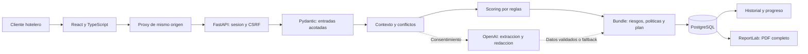

# Arquitectura, decisiones y amenazas

Revision 30/09/2026. La implementacion de referencia es la rama `codex/practica3`.

## Flujo

## Decisiones frente a la propuesta inicial

| Propuesta | Implementacion | Justificacion y limite |
|---|---|---|
| JWT y bcrypt/Passlib | Tokens opacos revocables y Argon2 | Cierre de sesion invalida el registro inmediatamente; hash mantenido por biblioteca probada. No hay refresh token ni SSO |
| PostgreSQL | PostgreSQL en Compose, SQLite en tests/desarrollo | Mismo modelo SQLAlchemy; SQLite no acredita rendimiento o concurrencia de PostgreSQL |
| Tablas separadas para cada resultado | Empresas y snapshots JSON versionados | Mantener exactamente respuestas/resultados de cada evaluacion; estados de acciones fuera del snapshot. Menos consultas analiticas SQL |
| Router, Tailwind, Recharts como opciones | Vistas con estado React, CSS existente y barras CSS | Alcance conservador; no hay URLs profundas ni navegacion atras por vista. Lucide si esta incorporado |
| IA para analisis | Extraccion opcional; puntuacion determinista | Un modelo no decide por si solo la puntuacion; el usuario confirma conflictos. No se demuestra precision semantica general |
| Let's Encrypt / Nginx | Nginx local, Caddy en Compose de produccion | TLS y renovacion con dominio configurado; no se ha emitido ni probado certificado publico de esta version |

Los IDs originales no se eliminan. Estos cambios afectan mecanismos, no eliminan usuarios, historico, politicas o PDF. Roles actuales: `hotel` y `admin`; no existe invitacion de consultores a equipos.

## Contratos y permisos

`auth/register`, `auth/login` y `health` son publicos. `auth/me`, `audit`, `records` y endpoints anteriores de analisis/politicas/IA requieren sesion. Mutaciones autenticadas exigen CSRF y verifican Origin cuando esta presente. Los clientes de terminal pueden no enviar Origin, pero necesitan cookie y CSRF.

Sesion: cookie HttpOnly, SameSite=Lax, Secure en produccion, expiracion predeterminada 60 minutos. La base solo almacena SHA-256 del token aleatorio y un token CSRF. Contrasenas: Argon2; nunca se devuelven hashes. El alta fuerza rol `hotel`; los administradores se promueven por CLI del operador, no por formulario. No hay recuperacion por correo ni verificacion de email: no atribuir identidad verificada al mero registro.

Cada lectura, PDF, actualizacion y borrado busca por ID y propietario. Se devuelve 404 al acceso cruzado para no confirmar existencia. El administrador puede listar usuarios, pero no recibe un permiso implicito para consultar todos sus analisis.

## STRIDE

| Amenaza | Ejemplo | Mitigacion implementada | Riesgo residual |
|---|---|---|---|
| Suplantacion | Robo de contrasena/cookie | Argon2, HttpOnly, expiracion, revocacion; HTTPS exigido en produccion | Sin MFA ni recuperacion segura; equipo comprometido |
| Manipulacion | Cambiar ID/estado o inyectar instrucciones | Propietario, Pydantic, enums, confirmacion de conflictos, prompts con datos separados | La IA puede equivocarse; no elimina prompt injection por completo |
| Repudio | Negar cambios de acciones | Auditoria de eventos con usuario y hora | Operador de DB puede alterarla; no es evidencia inmutable |
| Divulgacion | PDF de otra cuenta, clave publicada | Propiedad, secretos privados, no-store, escapado de texto PDF | Backups/discos no cifrados por esta app; texto sensible introducido por error |
| Denegacion | Muchos login o solicitudes IA | Limite de login por IP, IA por usuario, tiempo limite, 100 KB en proxy | Contadores en memoria por proceso; registro masivo y abuso distribuido requieren controles externos |
| Elevacion | Enviar rol admin al alta | Extra forbid y rol servidor; dependencias require_admin | Operador/CLI y acceso root son privilegiados |

El proxy debe ser el unico acceso externo a API; esta confia en los encabezados del proxy interno. Nginx/Caddy sobrescriben X-Forwarded-For para impedir que el cliente elija su IP. No exponer el puerto 8000 ni 5432. Un solo worker: cuotas locales no se comparten ni sobreviven a reinicios. Para escalar hacen falta Redis/cuotas compartidas y pruebas de concurrencia.

## Datos y conservacion

Finalidad: cuentas, autodiagnosticos y seguimiento. Datos: nombre/email de cuenta, nombre comercial, respuestas/contexto y actividad. Prohibir datos de huespedes, documentos, pagos y secretos en texto libre. El plazo `retention_days` es informacion declarada del hotel para la recomendacion: NO programa borrado de registros de esta app ni establece un plazo legal valido para todas las categorias.

El usuario puede borrar analisis o cuenta, con cascada de empresas/snapshots/sesiones/auditoria. Backups del operador requieren politica separada: la baja no borra magicamente copias offline. `python -m app.manage cleanup --audit-days 180` muestra registros elegibles; `--apply` elimina sesiones expiradas y eventos antiguos. No se ha configurado un temporizador del servidor; ejecutarlo y registrar su resultado forma parte de operacion.

OpenAI recibe perfil y contexto solo al autorizar IA en el flujo principal. No envia contrasena, email de cuenta o cookies. El nombre comercial/contexto pueden contener datos personales si el usuario los introduce: consentimiento UI no sustituye evaluar la base juridica, contratos y transferencias para un cliente real. API real de esta version pendiente de prueba con la cuenta del alumno; tests usan respuestas simuladas, sin gasto.

## Referencias

- OWASP Session Management: https://cheatsheetseries.owasp.org/cheatsheets/Session_Management_Cheat_Sheet.html
- OWASP CSRF: https://cheatsheetseries.owasp.org/cheatsheets/Cross-Site_Request_Forgery_Prevention_Cheat_Sheet.html
- Caddy Automatic HTTPS: https://caddyserver.com/docs/automatic-https
- Alembic: https://alembic.sqlalchemy.org/en/latest/tutorial.html
- SQLAlchemy: https://docs.sqlalchemy.org/en/20/orm/session_basics.html

No se ha realizado pentest externo, auditoria legal, analisis antivirus del equipo, analisis completo del historial de secretos ni escaneo de imagenes Docker. Auditorias de dependencias: ver registro de pruebas.
